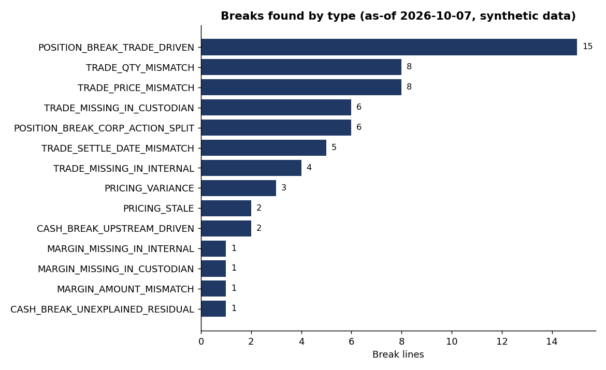
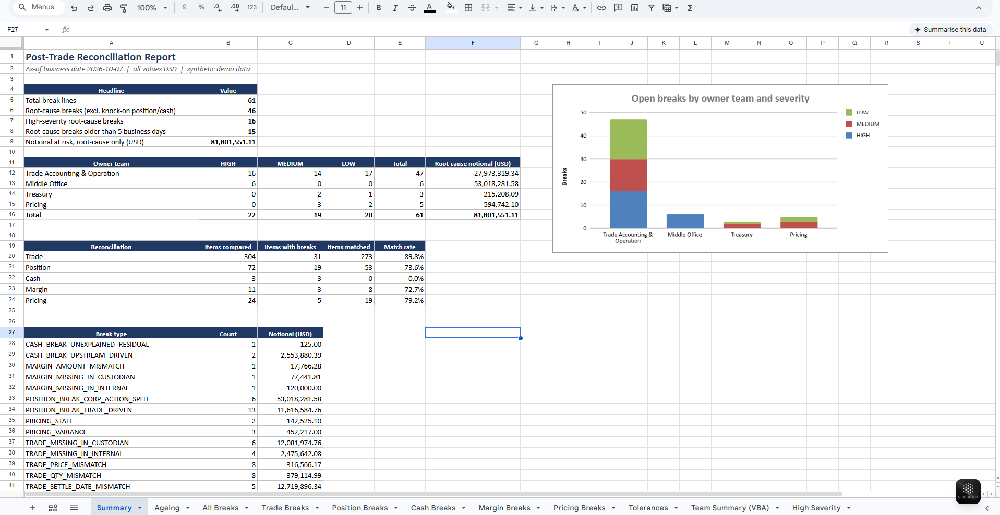

# Post-Trade Reconciliation Toolkit

Python + Excel + VBA toolkit that reconciles an investment platform against a custodian / administrator
and produces a break report an operations analyst can work from. It covers the post-trade life cycle:
trade, position, cash, margin and pricing reconciliation, with root-cause linking, ageing and severity.

> **All data is synthetic.** The generator plants a known set of breaks so the tests can prove the
> reconciler finds exactly those, and nothing else. No real securities, clients or counterparties.




## What it reconciles

| Reconciliation | Compares | Owner team in the report |
|---|---|---|
| Trade | Platform trades vs custodian trades (quantity, price within a bps tolerance, settle date, missing on either side) | Trade Accounting & Operation |
| Position | Platform vs custodian holdings, classified as trade-driven, corporate-action (split), or unexplained | Trade Accounting / Middle Office |
| Cash | Cash balances, with the difference decomposed into trade breaks, margin breaks, unbooked dividends and a residual | Trade Accounting & Operation |
| Margin | Margin movements by ID and amount | Treasury |
| Pricing | Platform price vs street price by asset-class tolerance; detects stale (prior-day) prices | Pricing |

## Why root-cause linking matters

One missing trade creates a trade break, a position break and a cash break. Working all three wastes time.
The toolkit tags the position and cash breaks as **knock-on** (`*_DRIVEN`) and names the trade IDs behind
them. Headline totals count **root-cause breaks only**, so notional is not double counted.
The cash reconciliation isolates a residual: a 125.00 custodian bank fee the platform never booked is
found as the single unexplained cash item.

## Run it

```bash
pip install -e ".[dev]"
postrade-recon demo            # generate sample data, reconcile, write output/recon_report.xlsx
pytest -q                      # 35 tests
```

Other commands: `postrade-recon generate --seed 7 --out data/mine` and
`postrade-recon run --data data/mine --as-of 2026-10-07 --out output`.
Point `run` at your own CSVs with the same column names as `data/sample/`.

## Sample run (as-of 2026-10-07)

| Reconciliation | Items compared | Items with breaks | Match rate |
|---|---:|---:|---:|
| Trade | 304 | 31 | 89.8% |
| Position | 72 | 21 | 70.8% |
| Cash | 3 | 3 | 0.0% |
| Margin | 11 | 3 | 72.7% |
| Pricing | 24 | 5 | 79.2% |

63 break lines, of which 46 are root causes and 17 are knock-on. Planted breaks recovered: 31 of 31 trade,
3 of 3 margin, 5 of 5 pricing, 6 split-driven position breaks, 1 cash residual. 6 trades with a 0.2 bps
price difference and 1 margin movement 0.50 off were correctly ignored as inside tolerance.

## The Excel report

`output/recon_report.xlsx`: **Summary** (live `COUNTIFS`/`SUMIFS` formulas and a chart), **Ageing**
(team by business-day bucket), **All Breaks** plus one sheet per reconciliation, and **Tolerances**
(every rule that defines a break). Filter or edit `All Breaks` and the totals update.

## VBA

`vba/ReconReport.bas` adds macros that format the break sheets, highlight breaks older than 5 business days,
build an independent team summary with a dictionary (a cross-check on the formula Summary) and export all
HIGH-severity lines to their own sheet. Import it via Alt+F11, save as `.xlsm`, run `RunAll`.

## Design decisions and limits

- Trade-date basis for positions; USD only; one custodian. Real books add multi-currency and FX.
- Ageing counts business days from settle date (trades, margin) or as-of date (others). Production would
  persist a break register so a break keeps its first-seen date across runs.
- Severity is notional based. A real desk would also weigh counterparty, settlement-fail risk and fund NAV.
- Tolerances are in `config.py` and are examples, not market standards.
- Corporate actions covered: splits and cash dividends only.

## Layout

```
src/postrade_recon/   config, datagen, recon, ageing, report, cli
tests/                35 tests: planted-break recovery, tolerances, explanations, ageing, report
vba/ReconReport.bas   Excel macros
data/sample/          synthetic CSVs      output/   generated report
```
